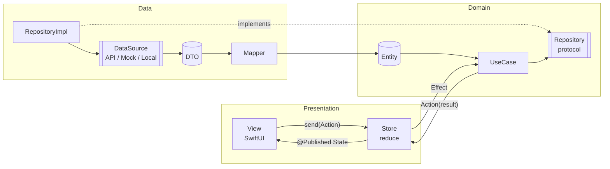
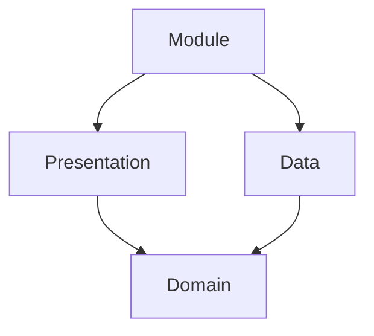
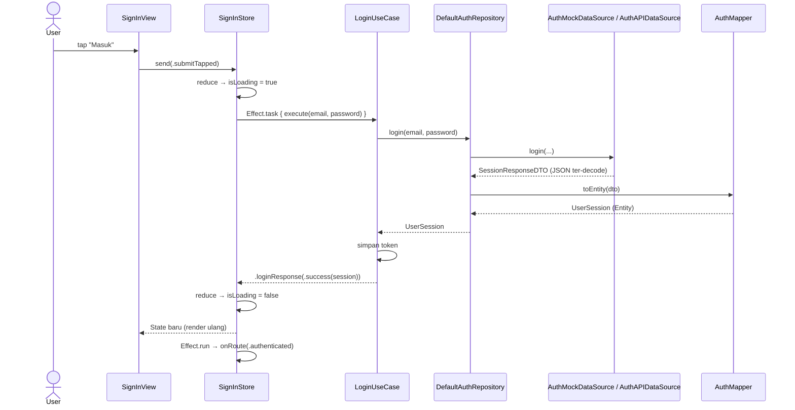
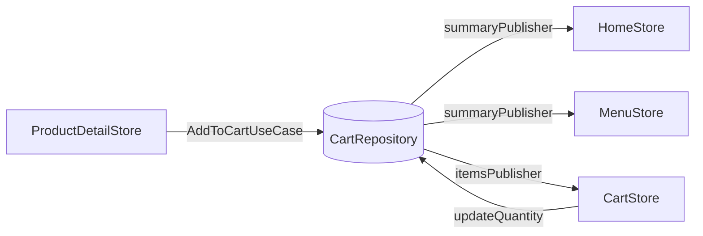

# Arsitektur iOS: UDF + Clean Layer

Panduan ini menjelaskan arsitektur yang dipakai di **TryTuist** dan bisa dipakai ulang di project iOS lain (SwiftUI, boleh dengan navigasi UIKit). Tidak butuh library pihak ketiga.

> **Ringkasnya:** setiap screen punya satu **Store** (State + Action + Reducer). Data dari backend masuk sebagai **DTO**, lalu diubah oleh **Mapper** menjadi **Entity** di layer Data. Presentation dan Domain tidak pernah menyentuh JSON atau response mentah.

---

## Daftar isi

1. [Kenapa arsitektur ini](#1-kenapa-arsitektur-ini)
2. [Gambaran besar](#2-gambaran-besar)
3. [Struktur folder](#3-struktur-folder)
4. [Aturan dependensi](#4-aturan-dependensi)
5. [Alur data end-to-end (contoh: Login)](#5-alur-data-end-to-end-contoh-login)
6. [Layer Data: DTO → Mapper → Entity](#6-layer-data-dto--mapper--entity)
7. [Layer Domain: Entity, Repository, UseCase](#7-layer-domain-entity-repository-usecase)
8. [Layer Presentation: UDF Store](#8-layer-presentation-udf-store)
9. [Module: composition root + routing](#9-module-composition-root--routing)
10. [Error handling](#10-error-handling)
11. [Environment & Mock vs API](#11-environment-dev--staging--prod--mock-vs-api)
12. [Testing](#12-testing)
13. [Checklist membuat feature baru](#13-checklist-membuat-feature-baru)
14. [Konvensi penamaan](#14-konvensi-penamaan)
15. [Memakai di project lain](#15-memakai-di-project-lain)

---

## 1. Kenapa arsitektur ini

| Opsi | Kelebihan | Kekurangan | Keputusan |
|---|---|---|---|
| **MVVM biasa** (`@Published` bebas di ViewModel) | Familiar, cepat ditulis | State bisa diubah dari mana saja, sulit dilacak; banyak `isLoading`, `error`, `data` yang saling tidak sinkron | ❌ |
| **TCA** (The Composable Architecture) | UDF lengkap, testing kuat | Dependency eksternal besar, kurva belajar curam, mengikat project ke library | ❌ untuk tim kecil/menengah |
| **VIPER** | Pemisahan sangat ketat | Boilerplate banyak (5+ file per screen), berat untuk SwiftUI | ❌ |
| **UDF ringan + Clean Layer** | State terprediksi, mudah dites, tanpa dependency, boilerplate sedang | Perlu disiplin mengikuti aturan | ✅ **Dipakai** |

Prinsip yang dijaga:

- **Single source of truth:** satu `State` per screen. View hanya merender `State`.
- **Satu arah:** `View → Action → Reducer → State → View`. Tidak ada jalan pintas.
- **Backend boleh berubah, app tidak ikut rusak:** perubahan JSON cukup diurus di DTO dan Mapper.
- **Bisa jalan tanpa backend:** setiap data source punya versi Mock yang menghasilkan JSON bentuk asli.

---

## 2. Gambaran besar



| Layer | Isinya | Boleh tahu | Tidak boleh tahu |
|---|---|---|---|
| **Presentation** | View, Store (State/Action/Route), komponen UI, formatter tampilan | Domain | DTO, JSON, URLSession, CoreData |
| **Domain** | Entity, protocol Repository, UseCase, error domain | Tidak ada (Swift murni) | SwiftUI, UIKit, NetworkManager, DTO |
| **Data** | DTO, Mapper, DataSource (API/Mock/Local), RepositoryImpl | Domain, NetworkManager, CoreData | View, Store |
| **Module** | Merakit semua dependency + routing | Semua layer di feature-nya | Feature lain |

---

## 3. Struktur folder

```
App/
└── Sources/
    ├── AppDelegate.swift
    ├── SceneDelegate.swift
    └── AppRouter.swift              # pilih root: Auth flow atau Tab bar

Foundations/                         # modul bersama (framework Tuist)
├── Navigation/                      # Router (UIHostingController), TabFeature, MainTabBarController
├── Utility/
│   └── Sources/Architecture/
│       ├── Store.swift              # Store<State, Action> + Effect
│       ├── Loadable.swift           # idle / loading / loaded / failed
│       ├── AppEnvironment.swift     # Dev/Staging/Prod dari Info.plist
│       └── AppConfig.swift          # useMockData
├── NetworkManager/                  # APIManager, EndpointAPI, APIEnvelope<T>, request async
├── CoreDataManager/
└── TTUI/                            # design system + formatter (Rp, tanggal)

Features/
└── <Nama>Feature/
    └── Sources/
        ├── <Nama>Module.swift       # composition root + routing
        ├── Data/
        │   ├── DTO/                 # cermin JSON backend
        │   ├── Mapper/              # DTO → Entity, error → DomainError
        │   ├── DataSource/          # Remote (API + Mock), Local (CoreData)
        │   └── Repository/          # Default<Nama>Repository
        ├── Domain/
        │   ├── Entity/
        │   ├── Repository/          # protocol + <Nama>Error
        │   └── UseCase/
        └── Presentation/
            └── <Screen>/
                ├── <Screen>Store.swift
                ├── <Screen>View.swift
                └── Components/
```

> Feature yang belum butuh data backend (contoh: Profil saat ini) cukup punya folder `Presentation/`, tapi **tetap memakai Store**. Tambahkan `Data/` dan `Domain/` saat mulai butuh data.
>
> Satu feature boleh punya beberapa pintu masuk. Contoh: `HomeFeature` (katalog F&B) mengekspos `HomeModule` (tab Beranda) dan `MenuModule` (tab Menu). Keduanya berbagi `CatalogContainer` (repository + keranjang) dan `CatalogFlow` (routing).

---

## 4. Aturan dependensi



1. **Domain tidak meng-import apa pun selain Foundation** (dan `Utility` untuk hal umum seperti `TokenStorage`).
2. **Presentation tidak pernah meng-import NetworkManager atau CoreDataManager.**
3. **Data tidak pernah meng-import SwiftUI.**
4. **Feature tidak saling import.** Komunikasi antar-feature lewat closure atau protocol di modul `Navigation`, dirakit di `AppRouter`.
5. Tipe di dalam feature cukup `internal`. Yang `public` hanya `<Nama>Module`.

---

## 5. Alur data end-to-end (contoh: Login)



---

## 6. Layer Data: DTO → Mapper → Entity

### 6.1 DTO: cermin JSON backend

- Namanya selalu `…DTO`.
- **Semua field optional.** Response yang kurang satu field tidak boleh membuat decode gagal total.
- Penamaan JSON (snake_case) ditangani lewat `CodingKeys`.
- Envelope standar backend memakai `APIEnvelope<T>` dari NetworkManager.

```swift
// Data/DTO/OrderDTO.swift
struct OrderDTO: Decodable {
    let orderID: String?
    let productName: String?
    let createdAt: String?     // "2024-08-20T12:46:00+07:00"
    let totalPrice: Int?
    let status: String?        // "PENDING" | "COMPLETED" | "FAILED"

    enum CodingKeys: String, CodingKey {
        case orderID = "order_id"
        case productName = "product_name"
        case createdAt = "created_at"
        case totalPrice = "total_price"
        case status
    }
}

typealias OrderListResponseDTO = APIEnvelope<[OrderDTO]>   // { code, message, data: [...] }
```

### 6.2 Mapper: satu-satunya tempat "menerjemahkan" backend

Tugas mapper:

| Dari (DTO) | Ke (Entity) | Contoh |
|---|---|---|
| `String?` tanggal ISO | `Date` | `"2024-08-20T12:46:00+07:00"` → `Date` |
| `String?` status | `enum` | `"COMPLETED"` → `.completed` |
| `Int` harga | `Decimal` | `15000` → `15000` (format "Rp" di Presentation) |
| `String?` URL | `URL?` | string kosong → `nil` |
| Field wajib kosong | buang item | `compactMap` → item rusak dibuang |
| `Error` teknis | `DomainError` | HTTP 401 → `.invalidCredentials` |

```swift
// Data/Mapper/OrderMapper.swift
enum OrderMapper {
    static func orders(from response: OrderListResponseDTO) -> [Order] {
        (response.data ?? []).compactMap { order(from: $0) }    // item tidak valid dibuang
    }

    static func order(from dto: OrderDTO) -> Order? {
        guard let id = dto.orderID,
              let name = dto.productName,
              let date = dto.createdAt.flatMap({ try? Date($0, strategy: .iso8601) }),
              let price = dto.totalPrice,
              let status = dto.status.flatMap({ OrderMapper.status(from: $0) }) else {
            return nil
        }
        return Order(id: id, productName: name, createdAt: date,
                     totalPrice: Decimal(price), status: status)
    }

    static func toDomainError(_ error: Error) -> OrderError {
        switch error {
        case let error as OrderError: return error
        case is URLError:             return .network
        case is DecodingError:        return .invalidResponse
        default:                      return .unknown
        }
    }
}
```

> **Aturan:** Mapper berupa `enum` dengan fungsi `static` murni, tanpa state dan tanpa side effect, jadi mudah dites.

> ⚠️ Di kondisi `guard`/`if`, closure harus di dalam kurung: `.flatMap({ ... })`. Trailing closure di sini membuat compile error.

### 6.3 DataSource: hanya bicara DTO

```swift
protocol OrderRemoteDataSource {
    func fetchOrders() async throws -> OrderListResponseDTO
}

struct OrderAPIDataSource: OrderRemoteDataSource {           // backend asli
    var api: APIManager = .shared
    func fetchOrders() async throws -> OrderListResponseDTO {
        try await api.request(.orders)
    }
}

struct OrderMockDataSource: OrderRemoteDataSource {          // tanpa backend
    func fetchOrders() async throws -> OrderListResponseDTO {
        try await Task.sleep(for: .milliseconds(500))
        return try JSONDecoder().decode(OrderListResponseDTO.self, from: Data(Self.json.utf8))
    }
    private static let json = #"{ "code": 200, "message": "success", "data": [ ... ] }"#
}
```

- **Mock harus mengembalikan JSON dengan bentuk asli**, bukan Entity jadi. Dengan begitu Mapper dan Repository ikut teruji.
- Mock mensimulasikan error seperti backend, misalnya `throw APIManager.APIError.invalidStatusCode(401)`.
- Data lokal (CoreData) memakai `LocalDataSource` yang `@MainActor` karena `viewContext` wajib di main thread. Mapping `NSManagedObject → Entity` juga dilakukan di main thread.

### 6.4 Repository implementation: perekat

```swift
struct DefaultOrderRepository: OrderRepository {
    let remote: OrderRemoteDataSource

    func fetchOrders() async throws -> [Order] {
        do {
            return OrderMapper.orders(from: try await remote.fetchOrders())
        } catch {
            throw OrderMapper.toDomainError(error)    // keluar dari Data selalu DomainError
        }
    }
}
```

Kalau nanti ada cache, offline-first, atau gabungan API + lokal, logikanya ada di sini. Store dan UseCase tidak perlu berubah.

---

## 7. Layer Domain: Entity, Repository, UseCase

### Entity

- `struct`, immutable (`let`), `Equatable`, `Identifiable` bila tampil di list.
- Tipe sudah "bersih": `Date`, `Decimal`, `URL?`, `enum`. Tidak ada `String` mentah untuk status atau tanggal.
- Tidak ada format tampilan (bukan `"Rp 15.000"`). Format dilakukan di Presentation.

```swift
struct Order: Identifiable, Equatable {
    let id: String
    let productName: String
    let createdAt: Date
    let totalPrice: Decimal
    let status: OrderStatus
}
```

### Repository (protocol) + error domain

```swift
protocol OrderRepository {
    func fetchOrders() async throws -> [Order]
}

enum OrderError: LocalizedError, Equatable {
    case network, invalidResponse, unknown
    var errorDescription: String? { /* pesan siap tampil */ }
}
```

### UseCase

Satu aturan bisnis, satu `struct` dengan `execute`. Pakai UseCase saat ada logika: validasi, gabung beberapa repository, sorting, atau menyimpan sesi.

```swift
struct GetOrdersUseCase {
    let repository: OrderRepository
    func execute() async throws -> [Order] {
        try await repository.fetchOrders().sorted { $0.createdAt > $1.createdAt }
    }
}

struct GetHomeContentUseCase {                 // gabung banyak sumber, paralel
    let repository: HomeRepository
    func execute() async throws -> HomeContent {
        async let banners  = repository.fetchBanners()
        async let products = repository.fetchProducts()
        return try await HomeContent(banners: banners, products: products)
    }
}
```

> Kalau UseCase hanya meneruskan panggilan repository tanpa logika, boleh dilewati: Store langsung memakai repository. Tetap konsisten dalam satu feature.

---

## 8. Layer Presentation: UDF Store

### 8.1 Inti (`Foundations/Utility/Sources/Architecture/Store.swift`)

```swift
@MainActor
open class Store<State, Action>: ObservableObject {
    @Published public private(set) var state: State
    public final func send(_ action: Action)                     // satu-satunya pintu masuk
    open func reduce(state: inout State, action: Action) -> Effect<Action>?   // override
    public func binding<V>(_ keyPath: KeyPath<State, V>, send: @escaping (V) -> Action) -> Binding<V>
    public func bind<P: Publisher>(_ publisher: P, to: @escaping (P.Output) -> Action)   // state bersama, lihat §8.6
}

public struct Effect<Action> {
    static func task(_ op: @escaping () async -> Action?) -> Effect   // kerja async → Action hasil
    static func run(_ work: @escaping @MainActor () -> Void) -> Effect // navigasi, analytics
}
```

### 8.2 Anatomi satu screen

```swift
// 1. State: semua yang dibutuhkan View, Equatable
struct OrdersState: Equatable {
    var filter: OrderStatus?
    var orders: Loadable<[Order]> = .idle
    var displayedOrders: [Order] { /* turunan dari state, bukan disimpan */ }
}

// 2. Action: intent user + hasil effect
enum OrdersAction {
    case onAppear
    case retryTapped
    case filterChanged(OrderStatus?)
    case ordersResponse(Result<[Order], OrderError>)
}

// 3. Route (opsional): navigasi keluar screen
enum OrdersRoute { case detail(Order) }

// 4. Store
final class OrdersStore: Store<OrdersState, OrdersAction> {
    private let getOrders: GetOrdersUseCase
    var onRoute: ((OrdersRoute) -> Void)?                // diset oleh Module

    init(getOrders: GetOrdersUseCase) {
        self.getOrders = getOrders
        super.init(initialState: OrdersState())
    }

    override func reduce(state: inout OrdersState, action: OrdersAction) -> Effect<OrdersAction>? {
        switch action {
        case .onAppear:
            guard state.orders.isIdle else { return nil }   // muat sekali saja
            return load(&state)

        case .retryTapped:
            return load(&state)

        case .filterChanged(let filter):
            state.filter = filter
            return nil

        case .ordersResponse(.success(let orders)):
            state.orders = .loaded(orders)
            return nil

        case .ordersResponse(.failure(let error)):
            state.orders = .failed(error.errorDescription ?? "")
            return nil
        }
    }

    private func load(_ state: inout OrdersState) -> Effect<OrdersAction> {
        state.orders = .loading
        let getOrders = self.getOrders                    // capture dependency, bukan self
        return .task {
            do    { return .ordersResponse(.success(try await getOrders.execute())) }
            catch { return .ordersResponse(.failure(error as? OrderError ?? .unknown)) }
        }
    }
}
```

### 8.3 View

```swift
struct FocusesView: View {
    @StateObject private var store: OrdersStore
    init(store: OrdersStore) { _store = StateObject(wrappedValue: store) }

    var body: some View {
        content
            .task { @MainActor in store.send(.onAppear) }
    }

    @ViewBuilder private var content: some View {
        switch store.state.orders {
        case .idle, .loading:      ProgressView()
        case .failed(let message): ErrorView(message) { store.send(.retryTapped) }
        case .loaded:              List(store.state.displayedOrders) { OrderRowView(order: $0) }
        }
    }
}

// TextField dua arah:
TextField("Email", text: store.binding(\.email, send: { .emailChanged($0) }))
```

### 8.4 Aturan Store

| ✅ Lakukan | ❌ Jangan |
|---|---|
| Ubah state hanya di `reduce` | Mengubah `state` dari View atau dari dalam `Task` |
| Kerja async lewat `Effect.task` | `Task { }` liar di View atau Store |
| Capture dependency (`let uc = self.useCase`) di effect | Capture `self` di `.task` |
| Navigasi lewat `Effect.run { onRoute?(...) }` | Store meng-import UIKit atau Router |
| Nilai turunan sebagai computed property di State | Menyimpan dua state yang bisa tidak sinkron |
| `Loadable<T>` untuk data async | Kombinasi `isLoading` + `error` + `data?` |
| Hasil effect sebagai `case xxxResponse(Result<…, DomainError>)` | Melempar `Error` mentah ke State |

### 8.5 Aturan wajib: setiap screen punya Store

**Semua screen** memakai pasangan `<Screen>Store` + `<Screen>View`, termasuk screen yang terlihat sederhana:

| Screen | Store | Logika di Store |
|---|---|---|
| Splash | `SplashStore` | timer, menentukan tujuan (`GetLaunchDestinationUseCase`) |
| Onboarding | `OnboardingStore` | halaman aktif, Lanjut/Lewati, tandai onboarding selesai |
| Sign In / Sign Up | `SignInStore` / `SignUpStore` | input, validasi, login/register |
| Beranda | `HomeStore` | muat konten, halaman banner, tambah cepat, badge keranjang, toast |
| Menu | `MenuStore` | pencarian, filter kategori, pengelompokan per kategori |
| Detail Produk | `ProductDetailStore` | varian, jumlah (1–20), catatan (maks 100), favorit, total harga, tambah ke keranjang |
| Keranjang | `CartStore` | ubah jumlah, hapus, ongkir, total, checkout |
| Pesanan | `OrdersStore` | muat & filter status |
| Profil | `ProfileStore` | promo, dialog logout, hapus sesi |

Di View **tidak boleh ada `@State`** untuk apa pun yang memengaruhi tampilan atau perilaku: halaman carousel, dialog, pilihan, jumlah, maupun teks input. Semuanya disimpan di State dan dibinding lewat `store.binding(\.x, send: { .xChanged($0) })`.

Pengecualian: `@FocusState` di komponen input dan state animasi murni di dalam komponen TTUI (misalnya `isRevealed` pada field password).

Screen yang benar-benar statis tanpa interaksi (contoh: `SettingDetailView` placeholder) boleh tanpa Store.

### 8.6 State bersama antar-screen (contoh: Keranjang)

Keranjang dipakai Beranda (badge + bar), Menu, Detail (tambah), dan Keranjang (ubah/hapus). Sumber kebenarannya **satu**, yaitu `CartRepository`. Store tidak saling memanggil; masing-masing **berlangganan** lewat `Store.bind`:

```swift
// Domain
@MainActor
protocol CartRepository: AnyObject {
    var summaryPublisher: AnyPublisher<CartSummary, Never> { get }
    var itemsPublisher: AnyPublisher<[CartItem], Never> { get }
    func add(_ item: CartItem) async throws
    func updateQuantity(itemID: String, quantity: Int) async
    func checkout() async throws -> PlacedOrder
}

// Presentation
final class HomeStore: Store<HomeState, HomeAction> {
    init(..., cart: CartRepository) {
        super.init(initialState: HomeState())
        bind(cart.summaryPublisher) { .cartChanged($0) }   // nilai baru → Action → reduce
    }
}
```



Instance repository dibagikan lewat container (`CatalogContainer.shared`) yang dirakit di layer Module.

### 8.7 Pola Toast (pesan sementara)

```swift
struct HomeState { var toast: ToastMessage? }

case .quickAddResponse(.success(let product)):
    let toast = ToastMessage("\(product.name) masuk keranjang")
    state.toast = toast
    return dismissToastEffect(id: toast.id) { .toastDismissed($0) }   // tutup otomatis 2 detik

case .toastDismissed(let id):
    if state.toast?.id == id { state.toast = nil }   // id mencegah toast baru ikut tertutup
    return nil
```

View cukup memanggil `.toast(state.toast)`.

Untuk toast setelah screen ditutup (contoh: tambah dari Detail lalu kembali), Store detail mengirim `Route.addedToCart(toast)`. Flow kemudian `pop()` dan meneruskan toast ke Store screen sebelumnya (`.toastRequested(toast)`).

---

### 8.8 Bottom sheet (TTUI) & sesi habis

Komponen inti di `Foundations/TTUI/Sources/Component/BottomSheet.swift`, tinggi otomatis mengikuti isi:

```swift
// 1. Standar: ikon + judul + pesan + tombol (style: info/success/warning/error)
let config = BottomSheetConfig(style: .error, title: "Pesanan gagal", message: "Coba lagi ya.",
                               primaryAction: .init("Coba lagi") { store.send(.retry) },
                               secondaryAction: .init("Nanti saja", role: .secondary))
BottomSheetPresenter.present(config, from: controller)   // dari Module / AppRouter
someView.bottomSheet(store.binding(\.sheet, send: { .sheetChanged($0) }))   // dari SwiftUI (State: BottomSheetConfig?)

// 2. Standar + konten tambahan
BottomSheetView(config, onAction: { ... }) { VoucherField() }

// 3. Isi bebas
BottomSheetPresenter.present(from: controller) { dismiss in MySheet(onClose: { dismiss(nil) }) }
```

Preset: `BottomSheetConfig.sessionExpired(onConfirm:)` (judul/pesan/tombol bisa diganti lewat parameter).

Alur sesi habis (global, feature tidak perlu menangani navigasinya):

```
API endpoint requiresAuth → 401
  → APIManager: SessionEvents.postExpired()          (Utility, NotificationCenter .sessionExpired)
  → AppRouter.handleSessionExpired(): hapus token, tampilkan bottom sheet (tidak bisa di-swipe)
  → "Mengerti": reset keranjang, tutup modal, ke Sign In
```

Store feature tetap boleh menampilkan pesan errornya sendiri (mis. `CartError.sessionExpired`); bottom sheet tampil di atasnya.
Uji tanpa backend: Debugger ▸ Navigasi ▸ "Simulasikan sesi habis".

## 9. Module: composition root + routing

Setiap feature punya satu file `<Nama>Module.swift`. Hanya tipe Module yang `public`. Kalau routing feature cukup banyak, pindahkan ke `<Nama>Flow` (contoh: `CatalogFlow`) dan simpan dependency bersama di `<Nama>Container`. Tugasnya:

1. **Merakit dependency:** DataSource → Repository → UseCase → Store.
2. **Memilih Mock atau API** berdasarkan `AppConfig.useMockData`.
3. **Routing:** menerima `Route` dari Store, lalu memanggil `router.push/setRoot/present`.

```swift
@MainActor
public final class FocusModule: TabFeature {
    public let tabItem = TabItem(title: "Pesanan", systemImage: "clock.arrow.circlepath", selectedSystemImage: "clock.arrow.circlepath")
    public init() {}

    public func start(router: Router) {
        let repository = DefaultOrderRepository(remote: Self.makeRemote())
        let store = OrdersStore(getOrders: GetOrdersUseCase(repository: repository))
        store.onRoute = { [weak router] route in
            switch route {
            case .detail(let order): router?.push(OrderDetailView(order: order), title: "Detail")
            }
        }
        router.setRoot(FocusesView(store: store), hidesNavigationBar: true)
    }

    private static func makeRemote() -> OrderRemoteDataSource {
        AppConfig.useMockData ? OrderMockDataSource() : OrderAPIDataSource()
    }
}
```

`Router` (modul Navigation) adalah satu-satunya tempat SwiftUI dibungkus ke `UIHostingController`, jadi tidak ada lagi ViewController per screen. Untuk project SwiftUI murni, ganti `Router` dengan `NavigationStack` + `path`. Store dan layer lain tidak berubah.

---

### 9.1 Navigasi antar-feature

Feature **tidak boleh** meng-import feature lain. Bila satu screen perlu membuka screen milik feature lain (contoh: Keranjang di HomeFeature → "Tambah alamat" di ProfileFeature):

1. Feature asal mendefinisikan route keluar yang publik: `public enum CatalogExternalRoute { case manageAddresses, managePaymentMethods }`, diterima lewat init module (`HomeModule(onExternalRoute:)`).
2. Feature tujuan membuka pintu masuk publik yang kecil: `ProfileModule.open(.addresses)`.
3. `AppRouter` (satu-satunya yang mengenal kedua feature) menyambungkan keduanya: pindah tab lalu panggil `open`.

Data yang dibutuhkan kedua feature (alamat, metode bayar) dibaca masing-masing lewat endpoint yang sama, dengan DTO/Entity sendiri. Keranjang hanya punya versi ringkas (`CheckoutAddress`, `CheckoutPaymentMethod`), jadi tidak ada dependency ke ProfileFeature.

## 10. Error handling

```
URLError / APIError.invalidStatusCode / DecodingError     ← Data (teknis)
                    │  Mapper.toDomainError
                    ▼
            AuthError / OrderError / HomeError            ← Domain (bermakna)
                    │  errorDescription
                    ▼
       state.errorMessage  /  Loadable.failed(String)      ← Presentation (siap tampil)
```

| Sumber | Dipetakan ke |
|---|---|
| `URLError` | `.network` |
| `DecodingError` / field wajib kosong | `.invalidResponse` |
| HTTP 400/401 (login) | `.invalidCredentials` |
| HTTP 409 (register) | `.emailAlreadyRegistered` |
| Lainnya | `.unknown` |

### 10.1 Form yang butuh pesan validasi dari server: `APIManager.send`

`request` hanya membawa kode status (`APIError.invalidStatusCode(400)`). Untuk form (Edit Profil, Alamat, E-Wallet) pakai `send`: status non-2xx menjadi `APIServerError` berisi `type`, `message`, dan `fieldErrors` (`["phone": "nomor HP tidak valid"]`) dari envelope error backend.

```swift
// Data
func updateProfile(_ param: UpdateProfileParam) async throws -> UserProfileResponseDTO {
    try await api.send(.updateProfile(param: param))
}

// Mapper
case let server as APIServerError where server.statusCode == 400:
    return .validation(message: server.message ?? "…", fields: server.fieldErrors)

// Presentation: key = nama field backend
InputFieldView(…, errorMessage: state.fieldErrors["phone"])
```

Validasi yang sama ditulis juga di UseCase (mis. `SaveAddressUseCase.validate`) supaya error tampil sebelum request dikirim. Server tetap sumber kebenaran: bila aturannya beda, pesan server yang tampil.

---

## 11. Environment (Dev / Staging / Prod) & Mock vs API

Setiap environment terdiri dari **1 build configuration + 1 xcconfig + 1 scheme**. Pilih environment cukup dengan memilih scheme di Xcode.

| Scheme | Configuration | Build | Bundle ID | Nama app | API | Mock |
|---|---|---|---|---|---|---|
| `TryTuist-Dev` | `Dev` | Debug | `com.lshinkuro.TryTuist.dev` | TryTuist Dev | `http://localhost:8080` | `YES` (ubah ke `NO` saat backend lokal jalan) |
| `TryTuist-Staging` | `Staging` | Release | `com.lshinkuro.TryTuist.staging` | TryTuist Staging | `https://staging-api.trytuist.com` | `NO` |
| `TryTuist-Prod` | `Prod` | Release | `com.lshinkuro.TryTuist` | TryTuist | `https://api.trytuist.com` | `NO` |

Alurnya:

```
Configs/Dev.xcconfig        API_BASE_URL = http:/$()/localhost:8080   ← "//" = komentar di xcconfig, pakai /$()/
        │ (build setting)
App/Info.plist              <key>API_BASE_URL</key><string>$(API_BASE_URL)</string>
        │ (runtime)
AppEnvironment.apiBaseURL   → BaseConstant.baseUrl → EndpointAPI
AppEnvironment.useMockData  → AppConfig.useMockData → <Feature>Module memilih Mock / API DataSource
```

- `Project.swift` → `enum AppEnv` mendefinisikan configuration + scheme untuk ketiganya.
- `make build ENV=Staging` untuk build per environment, `make build-all` untuk ketiganya.
- Selain Prod, versi di halaman Profil menampilkan environment (contoh: `1.0 · DEV`).
- `NSAllowsLocalNetworking` di Info.plist mengizinkan `http://localhost` untuk Dev; domain publik tetap wajib HTTPS.
- `API_KEY` di xcconfig **bukan rahasia** (bisa dibaca dari binary). Rahasia sungguhan hanya disimpan di server.

| Feature | Mock | API (kontrak di `API_PLAN.md`) |
|---|---|---|
| Auth (login/register) | `AuthMockDataSource`: akun `kholis@gmail.com / 12345678`, `demo@trytuist.com / password123`; akun hasil daftar disimpan di UserDefaults | `AuthAPIDataSource` → `POST /v1/auth/login`, `/v1/auth/register` |
| Katalog: Beranda & Menu | `CatalogMockDataSource` + `CatalogFixtures` (JSON + foto Unsplash) | `CatalogAPIDataSource` → `GET /v1/banners`, `/v1/categories`, `/v1/products` |
| Keranjang & checkout | `InMemoryCartRepository` | belum: `POST /v1/orders` (lihat API_PLAN.md fase 2) |
| Pesanan | `OrderMockDataSource` | `OrderAPIDataSource` → `GET /v1/orders` |

---

### 11.1 Debugger (shake device)

Modul `Foundations/Debugger`, aktif di build **Dev & Staging**, mati otomatis di **Prod** (`AppEnvironment.isDebugToolsEnabled`).
Cara buka: shake device. Di Simulator pakai **Device ▸ Shake** (⌃⌘Z).

| Tab | Isi | Sumber data |
|---|---|---|
| API | Semua request: method, status, durasi, ukuran, header, body (secret di-mask), salin cURL/URL/response, filter & cari | `NetworkInspector` (diisi `NetworkLogger`) |
| Layar | Screen yang sedang tampil, hierarki tab → stack → modal, riwayat layar, info app (env, base URL, token, versi) | `ScreenTracker` (dipanggil `HostingController.viewDidAppear`) |
| Navigasi | Shortcut ke Splash/Onboarding/Sign In/Sign Up, tiap tab, Keranjang, logout, reset onboarding, kosongkan keranjang, hapus cache gambar | `DebugMenu.shared.shortcutsProvider` di `AppRouter` |
| Server | Ganti environment/base URL/API key/mock tanpa build ulang, cek `/healthz` | `APIOverride` (UserDefaults) → dibaca `AppEnvironment` |

Alur ganti server: simpan `APIOverride` → `DebugMenu.onServerChanged` → `AppRouter` menghapus token, `CatalogSession.reset()`, lalu restart ke Splash.
Pilih **Bawaan build** untuk kembali ke nilai xcconfig.

Menambah shortcut fitur baru: tambahkan `DebugShortcut` di `AppRouter.debugShortcuts()`. Bila butuh masuk ke screen di dalam feature, buka method `public` kecil di Module feature itu (contoh `HomeModule.openCart()`), jangan expose Store/View.

Memakai di project lain: salin `Foundations/Debugger`, `NetworkInspector.swift`, `ScreenTracker.swift`, pakai `ShakeWindow` di SceneDelegate, lalu isi `shortcutsProvider` & `onServerChanged`.

## 12. Testing

Karena tiap layer terpisah, test ditulis tanpa network dan tanpa UI.

**Mapper** (fungsi murni):

```swift
func test_orderMapper_dropsUnknownStatus() throws {
    let json = #"{"code":200,"message":"ok","data":[{"order_id":"1","product_name":"Latte","created_at":"2024-08-20T12:46:00+07:00","total_price":15000,"status":"WEIRD"}]}"#
    let dto = try JSONDecoder().decode(OrderListResponseDTO.self, from: Data(json.utf8))
    XCTAssertTrue(OrderMapper.orders(from: dto).isEmpty)
}
```

**UseCase** dengan repository palsu:

```swift
struct StubOrderRepository: OrderRepository {
    var result: Result<[Order], OrderError>
    func fetchOrders() async throws -> [Order] { try result.get() }
}

func test_getOrders_sortsNewestFirst() async throws {
    let useCase = GetOrdersUseCase(repository: StubOrderRepository(result: .success([old, new])))
    let orders = try await useCase.execute()
    XCTAssertEqual(orders.first?.id, new.id)
}
```

**Store** (reducer):

```swift
@MainActor
func test_filterChanged_updatesState() {
    let store = OrdersStore(getOrders: GetOrdersUseCase(repository: StubOrderRepository(result: .success([]))))
    store.send(.filterChanged(.completed))
    XCTAssertEqual(store.state.filter, .completed)
}
```

> Supaya bisa di-test dari test target, tambahkan `@testable import <Feature>` dan buat test target per feature di `Project.swift`.

---

## 13. Checklist membuat feature baru

1. [ ] Tambah target di `Project.swift` (`.framework(.XFeature, …)`) dengan dependency `Utility, TTUI, NetworkManager, Navigation`.
2. [ ] **Domain:** buat `Entity`, `XRepository` (protocol) + `XError`, dan `UseCase` bila ada logika.
3. [ ] **Data:** buat `XDTO` (semua optional, `CodingKeys`) dan `XMapper` (DTO → Entity, `compactMap`, `toDomainError`).
4. [ ] **Data:** buat `XRemoteDataSource` (protocol), `XAPIDataSource` (tambah case di `EndpointAPI` bila perlu), `XMockDataSource` (JSON fixture asli), dan `DefaultXRepository`.
5. [ ] **Presentation:** untuk **setiap screen**, buat `XState` (Equatable, pakai `Loadable`), `XAction`, `XRoute`, `XStore`, dan `XView`. Jangan ada `@State` logika di View.
6. [ ] **Module:** buat `XModule` yang merakit dependency, memilih Mock/API, dan menangani `onRoute`.
7. [ ] Daftarkan di `AppRouter`, misalnya sebagai tab baru di `MainTabBarController(features: [...])`.
8. [ ] Tulis test untuk Mapper, UseCase, dan reducer.
9. [ ] Jalankan `make gen`.

---

## 14. Konvensi penamaan

| Jenis | Pola | Contoh |
|---|---|---|
| DTO | `<Nama>DTO`, envelope `typealias <Nama>ResponseDTO` | `OrderDTO`, `OrderListResponseDTO` |
| Mapper | `<Feature>Mapper` (`enum`, fungsi `static`) | `OrderMapper.order(from:)` |
| DataSource | `<Nama>RemoteDataSource` / `<Nama>APIDataSource` / `<Nama>MockDataSource` / `<Nama>LocalDataSource` | `AuthMockDataSource` |
| Repository | protocol `<Nama>Repository`, impl `Default<Nama>Repository` | `DefaultAuthRepository` |
| Error | `<Nama>Error` (`LocalizedError`) | `AuthError.invalidCredentials` |
| UseCase | `<Kata kerja><Objek>UseCase` + `execute()` | `GetOrdersUseCase`, `LoginUseCase` |
| State / Action / Route | `<Screen>State` / `<Screen>Action` / `<Screen>Route` | `SignInState` |
| Action dari user | `<sesuatu>Tapped`, `<field>Changed`, `onAppear` | `.submitTapped` |
| Action hasil effect | `<sesuatu>Response(Result<…>)` | `.loginResponse(...)` |
| Store | `<Screen>Store` | `HomeStore` |
| Module | `<Feature>Module` (satu-satunya `public`) | `HomeModule` |

---

## 15. Memakai di project lain

File yang cukup disalin (tanpa dependency eksternal):

| File | Fungsi |
|---|---|
| `Foundations/Utility/Sources/Architecture/Store.swift` | Store + Effect (inti UDF) |
| `Foundations/Utility/Sources/Architecture/Loadable.swift` | Status data async |
| `Foundations/Utility/Sources/Architecture/AppConfig.swift` | Switch Mock/API |
| `Foundations/Utility/Sources/Architecture/AppEnvironment.swift` + `Configs/*.xcconfig` + `enum AppEnv` di `Project.swift` | Environment Dev/Staging/Prod |
| `Foundations/NetworkManager/Sources/API/APIManager+Async.swift` | `request` async + `APIEnvelope<T>` |
| `Foundations/Navigation/` | Router UIKit + tab bar (opsional untuk project SwiftUI murni) |
| `Foundations/TTUI/Sources/Extension/Ext+Formatting.swift` | Format Rupiah & tanggal |
| `Foundations/TTUI/Sources/Component/RemoteImage.swift` | Gambar dari URL (AsyncImage) + placeholder & fallback |
| `Foundations/TTUI/Sources/Component/Toast.swift` | `ToastMessage` + modifier `.toast(_:)` |

Lalu ikuti struktur folder [§3](#3-struktur-folder) dan checklist [§13](#13-checklist-membuat-feature-baru). Contoh lengkap:

- `Features/FocuseFeature`: paling sederhana, satu screen.
- `Features/AuthenticationFeature`: UseCase, validasi, Mock/API.
- `Features/HomeFeature`: dua tab, state bersama (keranjang), toast, foto remote.

**Syarat minimum:** iOS 17 (memakai `ContentUnavailableView` dan `Task.sleep(for:)`). Untuk iOS 15–16, ganti dua API tersebut; arsitekturnya tetap sama.
