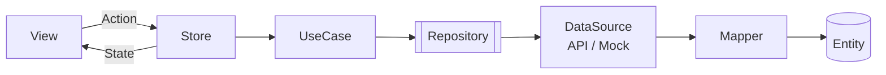
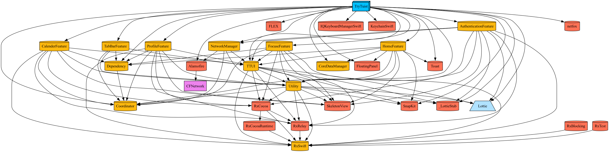

<div align="center">

# ☕ TryTuist

**Aplikasi pemesanan kopi & makanan untuk iOS, dibangun modular dengan Tuist + SwiftUI.**


</div>

---

## ✨ Fitur

| Area | Yang bisa dilakukan |
|---|---|
| 🔐 **Autentikasi** | Splash, onboarding, daftar & masuk (email / Google), lupa password |
| 🏠 **Beranda & Menu** | Banner, popup & harga promo, kategori, combo, pilih outlet, "Antar ke" dengan lokasi |
| 🛒 **Keranjang & Checkout** | Harga dari quote server, kupon ongkir, pembayaran online (Midtrans Snap) |
| 📦 **Pesanan** | Daftar & detail pesanan, beri rating |
| 👤 **Profil** | Edit profil, alamat, metode pembayaran, keamanan akun (verifikasi email, ganti password), bantuan, legal |
| 🧩 **Lainnya** | Widget *Best Seller*, notifikasi push (APNs), bahasa Indonesia / English, debugger (shake device) |

## 🧱 Arsitektur

Setiap screen punya satu **Store** (State + Action + Reducer). Data backend masuk sebagai **DTO**, diubah **Mapper** menjadi **Entity**. Presentation & Domain tidak pernah menyentuh JSON.



📖 Penjelasan lengkap: **[ARCHITECTURE.md](ARCHITECTURE.md)** · Kontrak API: **[API_PLAN.md](API_PLAN.md)**

### Struktur modul

```
App/            # AppDelegate, SceneDelegate, AppRouter (Auth flow ↔ Tab bar)
Widget/         # Widget Best Seller
Features/
├── AuthenticationFeature
├── HomeFeature          # beranda, menu, keranjang, pembayaran, favorit
├── FocuseFeature        # pesanan
└── ProfileFeature
Foundations/
├── Navigation           # Router & tab bar
├── TTUI                 # design system + formatter
├── Utility              # Store, Loadable, AppEnvironment
├── NetworkManager       # APIManager, EndpointAPI
├── CoreDataManager
└── Debugger             # inspector API, layar, server switcher
```

<details>
<summary>🗺️ Grafik dependensi</summary>



Regenerasi dengan `make graph`.
</details>

## 🚀 Mulai

**Prasyarat:** Xcode terbaru, [mise](https://mise.jdx.dev) (opsional, untuk Tuist versi yang di-pin).

```bash
git clone https://github.com/lshinkuro/TryTuist.git
cd TryTuist
make setup   # install Tuist sesuai .mise.toml
make gen     # tutup Xcode, install dependency, generate, buka workspace
```

Lalu pilih scheme `TryTuist-Dev` dan Run.

> 💡 Tanpa backend? Set `USE_MOCK_DATA = YES` di `Configs/Dev.xcconfig`.
> Akun mock: `demo@trytuist.com` / `password123`.

> ✍️ Signing: ganti `DEVELOPMENT_TEAM` di `Configs/Shared.xcconfig` dengan Team ID kamu.

## 🌍 Environment

| Scheme | Build | Bundle ID | API |
|---|---|---|---|
| `TryTuist-Dev` | Debug | `com.lshinkuro.TryTuist.dev` | backend lokal (lihat `Configs/Dev.xcconfig`) |
| `TryTuist-Staging` | Release | `com.lshinkuro.TryTuist.staging` | `https://staging-api.trytuist.com` |
| `TryTuist-Prod` | Release | `com.lshinkuro.TryTuist` | `https://api.trytuist.com` |

Nilai per environment ada di `Configs/<Env>.xcconfig` → `Info.plist` → `AppEnvironment`.
Untuk device fisik, arahkan `API_BASE_URL` di Dev ke IP Mac di LAN.

## 🛠️ Perintah Make

| Perintah | Fungsi |
|---|---|
| `make gen` | Tutup Xcode → install → generate → buka workspace |
| `make open` | Generate lalu buka workspace |
| `make generate` | Generate tanpa membuka Xcode |
| `make build ENV=Staging` | Build untuk simulator per environment |
| `make edit` | Edit manifest Tuist |
| `make graph` | Buat `graph.png` |
| `make clean` / `make reset` | Bersihkan cache Tuist / hapus project hasil generate |
| `make clean-derived` | Hapus DerivedData Xcode |

## 🐞 Debugger

Aktif di Dev & Staging. **Shake device** (Simulator: ⌃⌘Z) untuk membuka inspector request API, hierarki layar, shortcut navigasi, dan ganti server tanpa build ulang.

## 🔗 Repo terkait

| Repo | Stack |
|---|---|
| **trytuist** (ini) | iOS · Tuist · SwiftUI |
| **trytuist-api** | Go · chi · PostgreSQL |
| **trytuistadmin** | Next.js (admin web) |

---

<div align="center">
Dibuat dengan ☕ oleh <a href="https://github.com/lshinkuro">lshinkuro</a>
</div>
